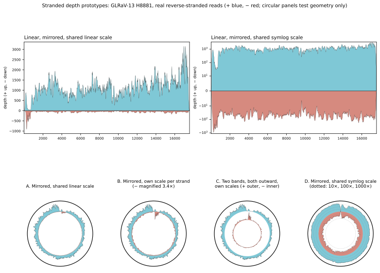

# Stranded depth — design notes

Branch `feature/stranded-maf`. Status: **investigation**; nothing on this
branch changes VirPlot's behaviour yet. Minor-allele frequency (MAF) is the
second feature planned for the branch and is sketched in §6.

The figure is made by `docs/design/stranded_prototypes.py` from the shipped
GLRaV-13 reads (`PYTHONPATH=src python3 docs/design/stranded_prototypes.py`).

---

## 1. What it is for

A stranded library keeps which RNA strand each read came from. VirPlot would
split each depth track in two:

* **+ssRNA viruses**: genomic (+) against antigenomic (−) RNA. The − strand is
  the replication intermediate, so its presence and its share of the depth
  are the usual evidence of active replication, and where it sits along the
  genome is information the aggregate trace hides.
* **Ambisense segments and circular DNA viruses**: + and − separate
  transcription in the two directions, the same split the annotation track
  already draws (§2 L2 and §3 C2 of `ictv_drawing_conventions.md`).

## 2. The shipped real library is stranded

`examples/glrav13.bam` (212,285 counted reads, all single-end):

| Read orientation | Reads | Share |
|---|---:|---:|
| reverse (flag 0x10) | 199,150 | 93.8% |
| forward | 13,135 | 6.2% |

An unstranded library would sit near 50/50. A 94/6 split from a +ssRNA virus
is what a **reverse-stranded** (dUTP-type) prep gives: the sequenced read is
antisense to the RNA, so a reverse-aligned read is a + strand molecule.

| | Mean | Median | Max |
|---|---:|---:|---:|
| + strand | 1,105× | 1,069× | 3,371× |
| − strand | 68× | 53× | 949× |

The two strands sum exactly to the unstranded depth VirPlot draws today
(checked position by position). The − strand is not uniform: + : − is 4.4 in
the first 2 kb (a − peak of ~900× in the first kilobase) and 13–25 in every
later 2 kb window.

One consequence for existing text: the aggregate 5′→3′ comparison in
`ictv_drawing_conventions.md` §6 K mixes in these 5′-heavy − strand reads.
Its numbers are worth re-measuring on the + strand alone once strands can be
separated.

## 3. Counting reads by strand

The strand of origin follows from the alignment orientation (flag 0x10) and,
for pairs, which mate the read is (0x40 read 1, 0x80 read 2):

| `--stranded` | Single-end or read 1 | Read 2 |
|---|---|---|
| `reverse` (dUTP-type; GLRaV-13) | RNA strand = opposite of alignment | same as alignment |
| `forward` | same as alignment | opposite of alignment |
| `no` (default) | one unstranded track, as today | |

With the mate rule both reads of a fragment land on the same RNA strand.

* **Code.** `depth_from_alignments` keeps two difference arrays instead of
  one. The test that matters is that + and − sum to the unstranded depth,
  which GLRaV-13 already passes.
* **Orientation report.** Log the forward/reverse split for every SAM/BAM,
  stranded or not. Warn when `--stranded no` meets a split as lopsided as
  94/6, or when `reverse` meets a majority of forward reads (likely the wrong
  setting).
* **Inputs.** Needs SAM/BAM, or reads mapped with `-x`. A `samtools depth`
  file has no strand, so `--stranded` with a `-d` depth file is an error.
* **Model.** `DepthTrack` gains a strand (`+`, `−` or none). `RNA.total_depth`
  stays the sum, so coverage intervals, gap shading and the CSV reports keep
  meaning what they mean now. Per-strand reports can follow.

## 4. Drawing: linear

Mirror about zero: + above, − below. This matches the annotation convention
for two-strand genomes (L2: + ORFs above the line, − below), so on an
ambisense segment each strand's depth sits on the same side as the ORFs it
covers.

* **One scale, asymmetric limits.** The y-limits run from −(max −) to +(max +)
  on one scale, so no space is spent on an empty half. At 16:1 the − band is
  thin but visible (top left of the figure).
* **`--yscale symlog`** already works in the linear layout and makes both
  strands readable on one honest scale (top right). It should be the
  suggested setting for +ssRNA libraries.
* **Several samples** stack per strand: upward for +, downward for −, one
  colour per sample on both sides.
* **Segmented genomes**: `prepare()` shares one maximum per strand across
  segments, so stacked panels keep a common scale.

## 5. Drawing: circular — does above/below the axis work?

Geometrically, yes. The zero line becomes a circle at the middle of today's
depth band (r = 0.48), + grows outward to 0.66, − inward to 0.30. Three
problems come with it.

1. **Ink bias between the strands.** On a circle, the same radial height
   covers more area farther out. For equal depth, the + side gets this much
   more area than the − side:

   | Depth, as a share of the scale | + area ÷ − area |
   |---|---:|
   | 25% | 1.10 |
   | 50% | 1.21 |
   | 100% | 1.46 |

   Radial height still encodes depth correctly, but the eye reads area. The
   bias falls on the comparison the plot exists to make. Today's single band
   has the same polar effect along depth (2.2× more arc per radian at the
   maximum than at zero), but it does not favour one series over another.
2. **Strand imbalance.** On a shared linear scale, GLRaV-13's mean − depth
   is 0.011 radius units, under 3 pt on the 8-inch figure: invisible
   (panel A). Giving each strand its own scale (B, C) makes it visible, but
   puts two scales on one figure. A **shared symlog radial scale** (D) shows
   both strands on one scale with reference rings. However, the circular
   layout ignores `--yscale symlog` today (`plotting.py` warns and draws
   linear), so that is new work.
3. **Space and labels.** Each strand gets half the band (0.18 radius instead
   of 0.36), and the − side runs toward the hub that holds the molecule's
   name. The depth scale at 12 o'clock needs three labels (0, + max, − max)
   where it has two.

**The stakes may be lower than the prototype suggests.** The circular genomes
VirPlot draws are DNA viruses (geminiviruses, GRBV, nanoviruses). Geminivirus
transcription runs in both directions from the intergenic region, so their
strand ratio may be much less lopsided than a +ssRNA virus's 16:1. This is
not measured: the repository has no stranded circular dataset.

**Recommendation.** Mirror in both layouts, with + outward and − inward on
the circle, on one shared scale. Add radial symlog to `CircularPlotter`
(panel D) with dotted reference rings. Do not offer per-strand scales by
default. Record the in/out area bias as a known limitation. Panel C (two
bands, both outward) is the fallback if review finds the bias objectionable.

## 6. Minor-allele frequency (later on this branch)

* The SAM/BAM reader skips SEQ and QUAL today. MAF needs the 4-bit BAM
  sequence (and SAM column 10) decoded into per-position A/C/G/T/deletion
  counts, with base-quality and minimum-depth thresholds.
* MAF at a position is 1 − (major allele count ÷ depth), so no reference
  FASTA is needed.
* Strand matters here too: a variant seen on one strand only is a classic
  artefact. The strand-split counts from §3 give a strand-bias filter at no
  extra cost.

## 7. Proposed order of work

1. `alignments.py`: per-strand counting, `--stranded`, the orientation
   report. Tests: the sum invariant; single-end, read 1 and read 2 under each
   setting; GLRaV-13's 94/6 split.
2. Model and CLI: strand on `DepthTrack`; reject `--stranded` with depth
   files.
3. Linear mirrored drawing, legend, shared limits, stacked samples.
4. Circular: mirrored ring and radial symlog.
5. Per-strand CSV columns.
6. GLRaV-13 drawn with `--stranded reverse` in `docs/make_figures.sh`;
   README and GFF/CLI docs.
7. MAF.
